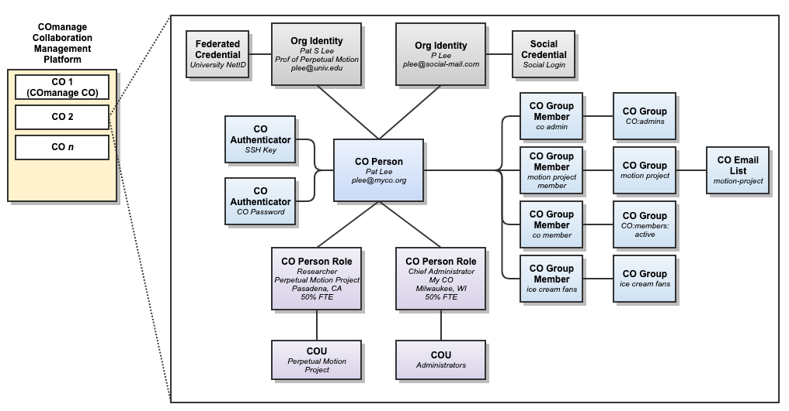
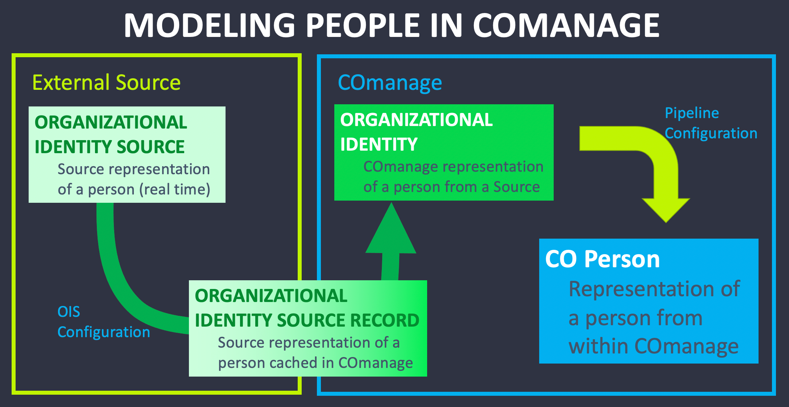
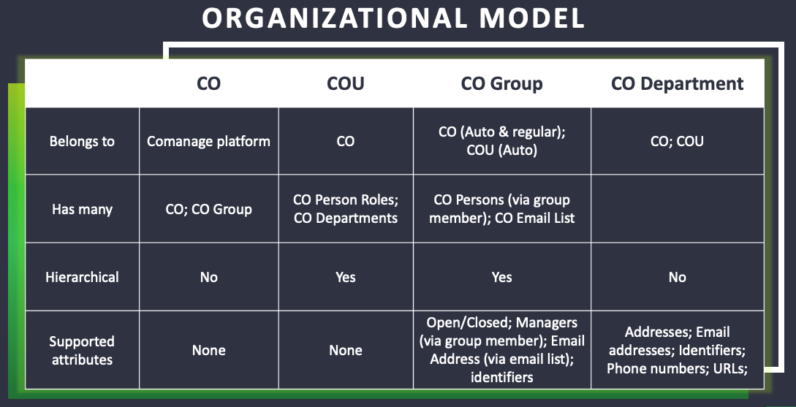

.. DRAFT — April 2026
.. Terminology status (confirmed from PE Technical Manual, Mar 2026):
..   All terms confirmed. Diagrams below use v4 terminology and are marked as such.
..   TODO: Replace diagrams with v5-updated versions when available.
..         v4 → v5 term mapping for diagrams:
..           "Org Identity" → "External Identity"
..           "Org Identity Source (OIS)" → "External Identity Source"
..           "Org Identity Source Record" → "External Identity Source Record"
..           "CO Person" → "Person"
..           "CO Person Role" → "Person Role"
..           "CO Authenticator" → "Authenticator"
..           "CO Group" → "Group"

.. _registry-structure:

How Registry Is Structured
===========================

.. sidebar:: On this page

   .. contents::
      :local:
      :depth: 1

Everything in Registry is organized around a single idea: **one Person record
per person, per CO**. Every other object in Registry exists to support,
describe, or connect to that Person record. Understanding how the pieces fit
together gives you a clear mental model for making configuration decisions and
for diagnosing problems when something isn't working as expected.

This page describes how Registry is structured at a conceptual level. For the
underlying database-level reference, see the
`Registry PE Data Model <https://spaces.at.internet2.edu/display/COmanage/Registry+PE+Data+Model>`_
in the Technical Manual.

1. The Platform and COs
------------------------

At the outermost level, Registry is a **Collaboration Management Platform
(CMP)** — the installation itself. It can host one or more **Collaborative
Organizations (COs)**. Each CO is a fully isolated space with its own people,
groups, configuration, and connections to external systems.

Most deployments have a single CO. Multiple COs in one CMP make sense when you
are running a shared Registry service for genuinely distinct organizations, or
when you need a separate environment for testing.

Registry also maintains its own internal CO — the **COmanage CO** — which is
used to manage platform-level settings and Platform Administrator group
membership. You will interact with it when setting up the platform for the
first time, but in day-to-day operation it stays in the background.

2. People: The Central Object
------------------------------

Within a CO, the **Person** record is the central object. It represents one
individual and their relationship with your organization. Registry's core
design principle is that each person has exactly one Person record within a CO,
no matter how many systems they appear in or how many roles they hold.

The Person record itself stores a relatively small amount of data directly:
names, identifiers, email addresses, and status. Most of the richness comes
from the objects connected to it — external identities, person roles, group
memberships, and attributes.

         Identities, Person Roles, COUs, Groups, Authenticators, and Email Lists
   :width: 100%

   How Registry is structured. *Note: this diagram uses v4 terminology.
   "Org Identity" = External Identity; "CO Person" = Person; "CO Person Role"
   = Person Role; "CO Authenticator" = Authenticator.*

3. External Identities: Where Data Comes From
----------------------------------------------

A Person record is built from **External Identities** — representations of that
person as known by external systems. Each External Identity captures what one
system of record knows about the person: their name, identifiers, email
addresses, affiliation, and other attributes as held by that source.

         External Identities, and Person records relate to each other
   :width: 80%

.. figure:: /comanage-files/registry/original-class/310-modeling-people/co310.5_modeling_people.png

    caption - this is the image from the submodule.

   How a person moves from an external source into Registry. *Note: this diagram
   uses v4 terminology. "Org Identity Source" = External Identity Source;
   "Org Identity" = External Identity; "CO Person" = Person.*

The flow from an external source into Registry works in layers:

**External Identity Source** (configured in Registry)
   Defines the connection to a source system — your HR system, student
   information system, LDAP directory, ORCID, or a file-based import. It tells
   Registry where to look and how to interpret what it finds.

**External Identity Source Record** (cached in Registry)
   A local copy of the source data, stored in Registry so it is available
   without querying the source every time. Registry can keep this cache
   synchronized on a schedule.

**External Identity** (attached to the Person record)
   Registry's own representation of the person from that source — the
   attributes mapped into Registry's object structure, linked to the Person record.
   A single Person record can have multiple External Identities, one for each
   source that knows about them.

**Pipeline Configuration** governs how incoming data flows from External
Identity Source Records into External Identities and onward to the Person
record. Pipelines define how attributes are mapped and how incoming records
are matched to existing Person records.

A Person record can also have External Identities that were not imported from
a source — created manually by an administrator or collected through an
enrollment flow. Not every person needs a connection to an external source.

4. Person Roles: Connecting People to COUs
-------------------------------------------

A **Person Role** captures information that is specific to one role a person
holds within the organization. A single Person record can have multiple Person
Roles — for example, someone who is simultaneously a researcher in one project
and an administrator in another, or holds positions in two departments.

Each Person Role carries the following attributes:

- **Affiliation** — the person's relationship to the organization (required;
  values such as faculty, staff, student, affiliate, and member are typical)
- **COU** — the Collaborative Organizational Unit this role belongs to
  (optional; if none, the role belongs directly to the CO)
- **Department** — the sub-unit within the COU or CO
- **Organization** — the institution or entity; useful in multi-institution COs
- **Title** — the person's title for this role
- **Manager** and **Sponsor** — references to other Person records in the CO
- **Status** — the lifecycle status of this role
- **Validity dates** — the date range during which this role is considered
  active

Person Roles can be ordered within a single Person record. They can also carry
multi-valued secondary attributes: Ad Hoc Attributes, Addresses, Telephone
Numbers, and URLs.

Person Roles are the mechanism that connects a Person to a COU. A Person Role
in a COU makes the person a member of that COU, which determines which COU
Administrators can manage them and which enrollment flow policies apply.

5. Status and the Identity Lifecycle
--------------------------------------

Every Person Role has a **status** that reflects where that role stands in the
identity lifecycle. The Person record's overall status is the "most preferred"
status across all of its Person Roles — meaning the most active status wins.
For example, a person with one Active role and one Expired role has an overall
status of Active.

The statuses most relevant to day-to-day administration:

**Active**
   The person or role is active and fully provisioned. Person data, role data,
   and group memberships are all propagated to connected systems.

**Grace Period**
   The association has ended but services have not yet been deprovisioned. A
   person in Grace Period receives the same provisioning as an Active person.
   Grace Period gives time to wind down access in an orderly way before the
   full expiration takes effect.

**Suspended**
   The association has been temporarily suspended. Person data and membership
   in All Members groups remains provisioned, but active group memberships are
   not.

**Expired**
   The valid through date has been reached. The person's data remains in
   Registry but provisioning is reduced to person data and All Members groups
   only.

**Pending Activation**
   The valid from date has not yet been reached. No data is provisioned.

**Archived**
   The record is not expected to be reactivated. No data is provisioned.

**Locked** *(Person-level only)*
   A CO or COU Administrator has locked the Person record entirely, disabling
   it regardless of the underlying Person Role statuses. Enrollment Flows,
   Pipelines, and Expiration Policies cannot reset a Locked status — only an
   administrator can clear it manually. Note that Locking a Person does not
   lock their Authenticators; applications should check authorization
   information, which is deprovisioned when a record is Locked.

Statuses in the enrollment workflow (such as Pending Approval, Confirmed, and
Approved) are transient: they appear during an active enrollment process and
result in no data being provisioned until enrollment completes.

Status can change automatically — through Pipeline syncs, Expiration Policies,
or validity date transitions — or manually by an administrator. Automatic
updates will overwrite manual changes unless the Person is Locked or the
specific Person Role is Frozen.

For the full status reference including External Identity statuses and
provisioning behavior, see `Person and External Identity Status
<https://spaces.at.internet2.edu/display/COmanage/Person+and+External+Identity+Status>`_
in the Technical Manual.

6. Organizational Structure: COUs and Groups
---------------------------------------------

Registry provides two tools for organizing your population within a CO: COUs
and Groups. They serve different purposes and work at different levels of
Registry's structure.

         of membership, hierarchy, and supported attributes
   :width: 90%

   Comparison of CO, COU, and Group along key dimensions. *Note: this diagram
   uses v4 terminology.*

**COUs** model the hierarchical structure of your organization. COUs can be
nested to represent complex hierarchies, and COU Administrators can be delegated
responsibility for their COU and its children. COUs exist primarily to support
different management policies and delegation across sub-populations.

**Groups** are more flexible. A Group can contain any set of Person records
regardless of their COU membership. Groups drive provisioning (who gets access
to what systems), mailing list membership, administrative role assignment, and
more. Groups can be open (members can self-join) or closed (membership is
managed by owners or administrators).

Every CO and COU automatically has a set of system-managed Groups:

- ``CO:admins`` / ``CO:COU:Name:admins`` — the administrators of this CO or COU
- ``CO:members:all`` / ``CO:COU:Name:members:all`` — all Person records
  regardless of status
- ``CO:members:active`` / ``CO:COU:Name:members:active`` — Person records with
  an Active or Grace Period status

These automatic groups are how Registry implements administrative roles and how
provisioning rules can target active members without custom configuration.

7. Authenticators
------------------

**Authenticators** define how a Person can sign in to services. A Person record
can have multiple Authenticators — for example, an SSH key and a password.
Authenticators are attached to the Person record and managed separately from
the External Identities that provide the person's identity data.

Available Authenticator types in v5 include Password and SSH Key. Authenticator
configuration is handled through plugins.

8. Secondary Objects: Attributes
----------------------------------

Many of the attributes associated with a Person record, External Identity, or
Person Role are stored as **Secondary Objects** — separate records linked to
their parent. This structure supports the multi-valued attribute model: a
person can have multiple names, multiple email addresses, multiple identifiers,
and so on.

The secondary objects attached to Person records, External Identities, and
Person Roles include:

- **Names** — given name, family name, and other name components; one must be
  designated as the primary name
- **Identifiers** — internal Registry IDs, ePPN, ePTID, ORCID, and others;
  identifiers are the primary mechanism for provisioning and linking records
  across systems
- **Email Addresses** — one or more, with types (official, personal, preferred,
  etc.)
- **Addresses** — physical addresses
- **Telephone Numbers**
- **URLs**
- **Preferred Pronouns** *(experimental in v5)*
- **Ad Hoc Attributes** — custom attributes you define for your organization's
  specific needs

9. Artifacts: Records of What Happened
----------------------------------------

**Artifacts** are records created automatically by Registry as a byproduct of
its processes. Unlike configuration or person data, artifacts are read-only once
the process that created them is complete. They exist to support audit trails,
troubleshooting, and transparency.

Key artifacts include:

**History Records** — a transaction log attached to most objects in Registry.
Every significant change to a Person record, Group membership, or enrollment
petition generates a history record. History records are how you answer the
question "who changed this, and when?"

**Petitions** — the record of an enrollment. A petition captures the attributes
collected during enrollment, the steps the petitioner and enrollee went through,
and who approved it. Petitions persist even after enrollment is complete,
providing a durable record of how someone came to be in Registry.

**Notifications** — generated when Registry needs to alert someone to an event,
such as a pending approval or an expiring role.

----

Putting It Together
--------------------

How Registry is structured, from outermost to innermost:

- The **CMP** (Registry installation) hosts one or more **COs**.
- Each **CO** has its own **People**, **Groups**, **COUs**, and configuration.
- Each **Person** record has **External Identities** (where they came from),
  **Person Roles** (what they do and which COUs they belong to),
  **Authenticators** (how they sign in), **Group Memberships**, and
  **Attributes** (names, identifiers, email addresses, etc.).
- **Pipelines** govern how data flows from External Identity Sources into
  External Identities and onward to Person records.
- **Artifacts** (history records, petitions, notifications) track what
  Registry has done over time.

.. seealso::

   :doc:`Registry Concepts Overview </understanding/concepts-overview>`
      A plain-language introduction to the same ideas.

   :doc:`Roles and Permissions </understanding/roles>`
      How administrative access is structured within Registry.

   :doc:`Planning Your Implementation </understanding/planning>`
      Working through your organization's needs before configuring Registry.

   `Registry PE Data Model <https://spaces.at.internet2.edu/display/COmanage/Registry+PE+Data+Model>`_
      The full technical reference with table-level detail.

   `Registry Objects <https://spaces.at.internet2.edu/display/COmanage/Registry+Objects>`_
      Primary and Secondary Registry Objects in the Technical Manual.

   `Person and External Identity Status <https://spaces.at.internet2.edu/display/COmanage/Person+and+External+Identity+Status>`_
      Full status reference with provisioning behavior for each status value.
